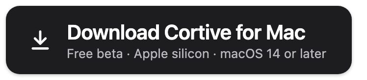
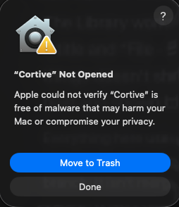
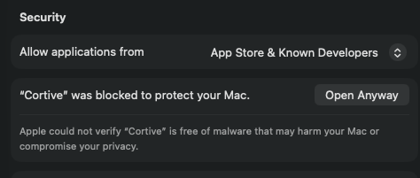

# Cortive

**Save what you read. Find it again by what it meant.**

Cortive is a private knowledge base for your Mac. It keeps the pages, passages, PDFs, screenshots, documents, voice memos and clipboard snippets you choose to save, and finds them again by meaning, with an on-device model. Everything stays on your Mac: no account, no cloud, no telemetry.

This repository holds Cortive's downloads and release notes. Cortive is free during the public beta.

## Install

<a href="https://github.com/KadenDevAi/cortive-releases/releases/latest/download/Cortive.dmg"></a>

Needs an Apple silicon Mac (M1 or later) with macOS 14 Sonoma or later.

1. **Open the download** and drag Cortive into Applications.
2. **Open Cortive.** The first time, macOS says it can't check Cortive for malware and doesn't open it. That's expected: the beta isn't signed with a paid Apple Developer account yet. Click **Done**, not Move to Trash.

   

3. **Open System Settings → Privacy & Security**, scroll to **Security** at the very bottom and click **Open Anyway** next to Cortive. Confirm, then use your Mac password or Touch ID. You only do this once.

   

4. **Add the Chrome extension** from the [Chrome Web Store](https://chromewebstore.google.com/detail/cortive/aebpbfkdpggpnigojbnhkcnemngjifia). It saves pages, passages and links with a right-click or a keyboard shortcut, and lets you search Cortive from any tab. If another browser is already connected to Cortive, approve the new one in Cortive's **Settings**.

On first launch Cortive downloads its on-device search files (about 865 MB, from Hugging Face) and asks for Screen Recording, which it uses only when you take a screenshot capture.

<details>
<summary><b>Comfortable with Terminal?</b> Install with one line and skip steps 1–3.</summary>

```bash
curl -fsSL https://raw.githubusercontent.com/KadenDevAi/cortive-releases/main/install.sh | bash
```

It downloads the latest release from this page, checks it against its SHA-256 checksum, puts Cortive in Applications and opens it. [Read the script](install.sh) first if you like; it's short.

</details>

## Use Cortive as your AI agent's memory

The [Cortive memory plugin for Hermes Agent](https://github.com/KadenDevAi/hermes-cortive) lets Hermes recall what you saved, read-only, with meaning search while Cortive is running:

```bash
hermes plugins install KadenDevAi/hermes-cortive
hermes config set memory.provider cortive
```

## Privacy

[PRIVACY.md](PRIVACY.md) lists every connection Cortive makes. In short: the one-time search-files download, an optional update check against this repository, and nothing else. Your library never leaves your Mac.

## Feedback

Report problems in [Issues](https://github.com/KadenDevAi/cortive-releases/issues), or use **Report a Problem** in Cortive (Settings → Help), which drafts an email to cortiveai@gmail.com.

© 2026 Kaden Desmarais. Cortive is free to use during the beta; the app's source code is not public.
